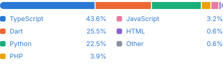
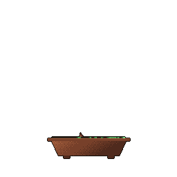

  

Software developer working across web and backend development, ERP systems, mobile apps and industrial control systems. View my [portfolio](https://esmailga.github.io/site/).

<table width="100%">
  <tr>
    <td width="70%" valign="top">
      <h3>Tech Stack</h3>
      

  
  
  
  
  
  
  
  
  
  
  
  
  
  
  
  
  
  
  
  
  
  
      

    </td>
    <td width="30%" align="center" valign="top">
      
    </td>
  </tr>
</table>

<table width="100%">
  <tr>
    <td width="80%" valign="top">
      <h3>Language Breakdown</h3>
      
    </td>
    <td width="20%" align="center" valign="bottom">
      
    </td>
  </tr>
</table>

<h3>Featured Projects</h3>

| Project | What it is | Built with |
|---|---|---|
| [Shams Solutions](https://shamss.io) | Bilingual (English / Arabic) website for an ERP and digital transformation company in Saudi Arabia ([live](https://shamss.io)) | React, TypeScript, Express, Firebase |
| [samaform](https://github.com/esmailga/samaform) | Architecture firm website and multi-step intake form ([live](https://www.samaform.com)) | React, TypeScript, PHP, SQLite |
| [iot-sae-ids](https://github.com/esmailga/iot-sae-ids) | Lightweight IoT intrusion detection using a sparse autoencoder | Python, scikit-learn, pandas |
| [Flexibleea](https://github.com/esmailga/Flexibleea) | Freelancer marketplace app where recruiters browse, request and review freelancers | Flutter, Dart, Firebase |
